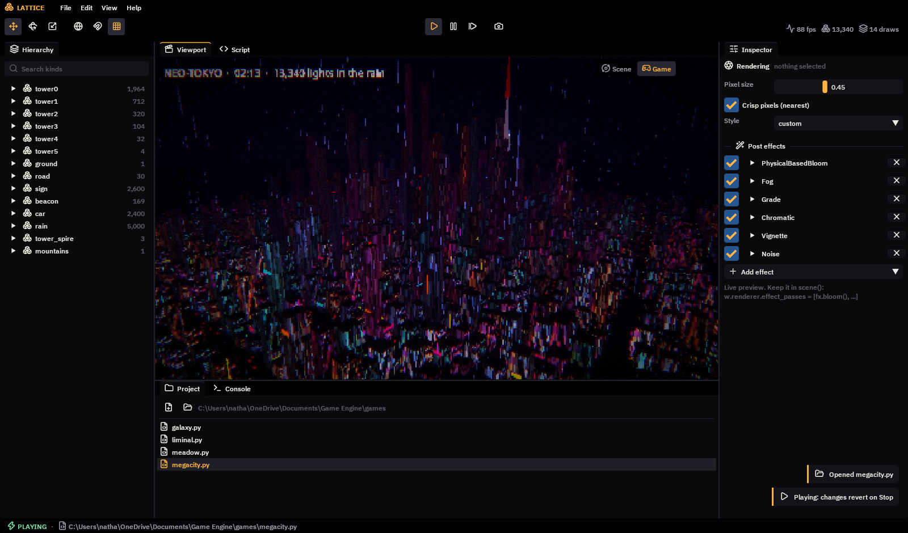
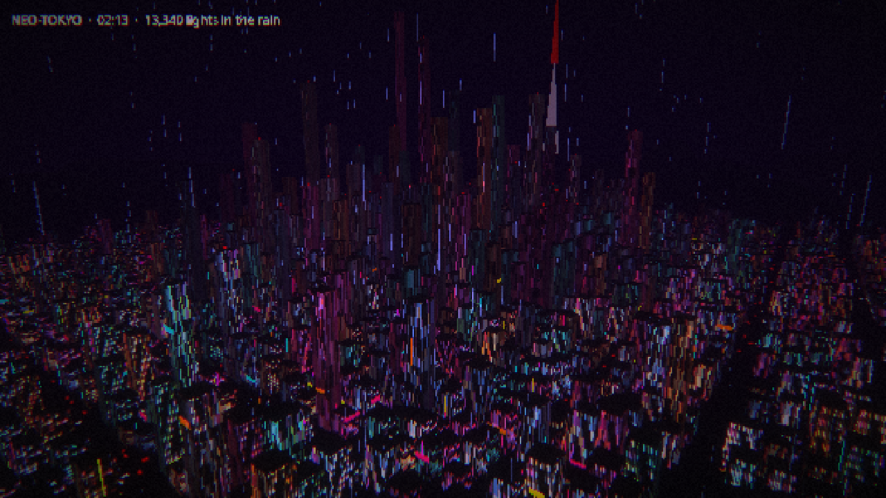
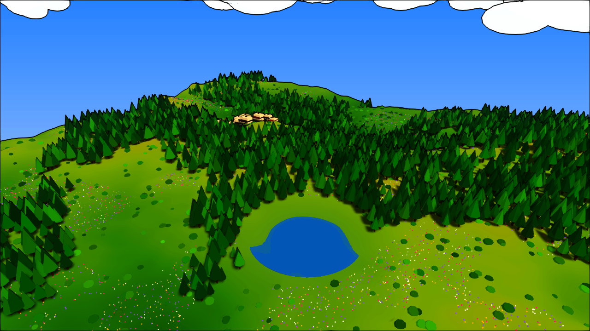
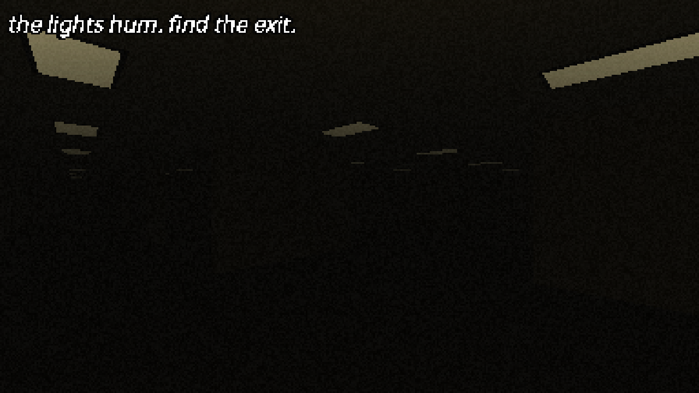
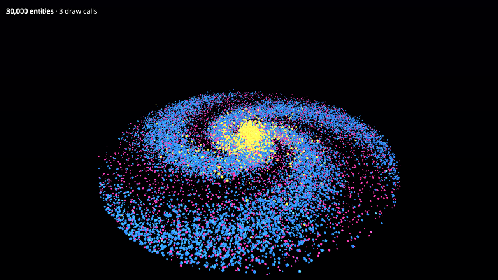
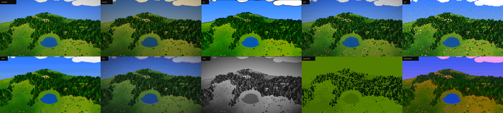
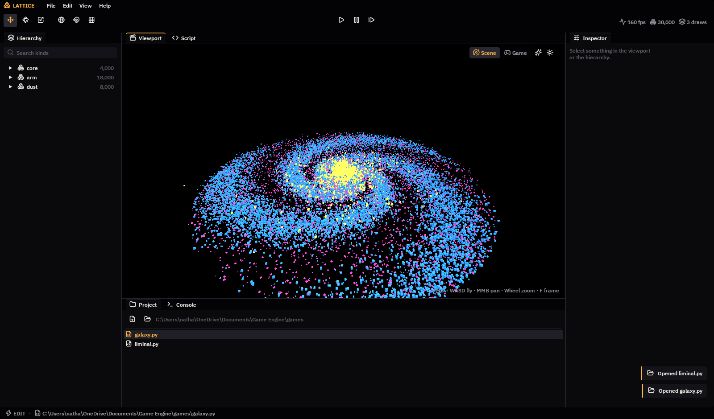

<div align="center">

# LATTICE

**A 3D game engine where games are Python files, worlds are arrays, and everything is live.**

`Python 3.12` · `WebGPU` · `NumPy` · `Dear ImGui` · `uv`



</div>

---

Most Python engines give every entity its own Python object, so the interpreter runs once per enemy, bullet and star, every frame. Lattice doesn't. **Each kind of thing is a table of NumPy columns, and each table is drawn as one GPU instanced mesh.** Game logic is array maths over whole tables at once, so Python's cost scales with the number of *kinds*, not the number of *things*.

```python
k.pos += k.vel * w.dt          # moves every star at once
w.enemy.kill(w.enemy.hp <= 0)  # removes every dead enemy at once
```

The demo galaxy simulates **30,000 tumbling, orbiting entities in 3 draw calls**, and stays smooth. Neo-Tokyo puts 13,000 towers, neon signs, cars and raindrops on screen in 14.

## Highlights

| | |
|---|---|
| **Games are one `.py` file** | Three optional hooks: `scene(w)` for looks, `setup(w)` for the starting state, `update(w)` for every frame. |
| **Hot reload that keeps state** | Save the file and the code is swapped while the world keeps running. Errors show on screen, and the game resumes as soon as you fix them. |
| **Data-oriented by default** | Entities are rows. Components are columns. Systems are NumPy expressions. |
| **A real editor** | Docked panels, transform gizmos, click-to-select, Play/Pause/Step, undo/redo, a built-in code editor, console and project browser. |
| **Play mode that reverts** | Press Play, wreck everything, press Stop, and you're back where you were. `World.snapshot()` makes it free. |
| **Playable screenshots** | Press **F12** and you get a PNG that is also the game. Open it in Lattice and you're back in that exact moment, with the same entities, game state and camera. |
| **One-word art direction** | `fx.style(w, "cel")` switches resolution, filtering, shading model and the whole post stack. There are ten styles, from `realistic` and `source` to `ps1`, `vhs` and `gameboy`. |
| **Shaders in a few lines** | `fx.shader("color = ...")` turns a WGSL snippet into a hot-reloaded post effect. Bloom, outline, posterize/dither, chromatic aberration, scanlines, grading and palette mapping are already built in. |
| **Materials, models, audio** | Choose a shading model by name (`basic`, `phong`, `toon`, `standard`, `physical`). Texture maps come from a file path or a NumPy array. glTF/GLB models import in one call. A NumPy mixer plays sound files, or arrays you synthesise yourself. |
| **Per-instance colour** | Every kind has a `tint` column, so a thousand differently coloured signs are still one draw call. |
| **Worlds from a seed** | `gen` has vectorised noise, terrain with height-ramp colours, scattering, palettes and city lots. A lush valley takes about 60 lines. |
| **Stylised rendering built in** | PBR, shadows, fog, film grain, bloom and low-resolution pixel upscaling come from [pygfx](https://github.com/pygfx/pygfx) on WebGPU (Vulkan, Metal or DX12). |

<table>
<tr>
<td></td>
<td></td>
</tr>
<tr>
<td align="center"><b>Neo-Tokyo</b><br>A rain-soaked neon megacity, 13,000 lights in 14 draw calls.</td>
<td align="center"><b>Meadow</b><br>A lush valley grown from one seed, in about 60 lines.</td>
</tr>
<tr>
<td></td>
<td></td>
</tr>
<tr>
<td align="center"><b>Fluorescent</b><br>PS2-era liminal horror. It only moves when you aren't looking.</td>
<td align="center"><b>Galaxy</b><br>30,000 entities, a few lines of NumPy.</td>
</tr>
</table>

> Every image above is a playable screenshot. Download one and run `uv run lattice play megacity.png`.

## Quick start

You need [uv](https://docs.astral.sh/uv/) and a GPU with Vulkan, Metal or DX12 support.

```sh
git clone <this repo> lattice && cd lattice
uv sync

uv run lattice                          # open the editor
uv run lattice edit games/liminal.py    # open a game in the editor
uv run lattice play games/liminal.py    # just play it, in a plain window
uv run lattice play docs/megacity.png   # ...or resume a playable screenshot
```

Press **Esc** at any time to free the mouse.

## A whole game

```python
import numpy as np
import pygfx as gfx

def scene(w):                                   # looks: re-run on every save
    w.kind("ground", gfx.box_geometry(), "#2a2a32")
    w.kind("cube", gfx.box_geometry(), "#ffb347", spin=0.0)

def setup(w):                                   # starting state: run once
    w.ground.spawn(pos=(0, -0.5, 0), scale=(40, 1, 40))
    xz = np.mgrid[-4:5, -4:5].reshape(2, -1).T * 2.0
    w.cube.spawn(len(xz), pos=np.c_[xz[:, 0], np.full(len(xz), 0.5), xz[:, 1]],
                 spin=np.random.uniform(-2, 2, len(xz)))
    w.camera.local.position = (12, 10, 14)
    w.camera.look_at((0, 0, 0))

def update(w):                                  # every frame
    c = w.cube
    c.pos[:, 1] = 0.5 + np.abs(np.sin(w.t * 2 + c.pos[:, 0]))
```

**File → New Game** in the editor writes exactly this for you.

## Playable screenshots

A screenshot is a normal PNG with a zip appended after the image data. Image viewers, browsers, Discord and GitHub just see a picture. Lattice, or any unzip tool, finds:

- the game's `.py` file and every asset it loaded (textures, models, sounds);
- `moment.npz`, the entity tables at that instant;
- `state.pkl` (your `w.*` game state) and `lattice.json` (time, HUD, camera).

Opening the PNG (from the CLI, **File → Open**, or by dropping it on the window) unpacks it into `~/.lattice/shots/`, loads the game, restores the moment and presses Play. **Stop** returns you to the moment, and **F5** restarts the game from the beginning.

A shot carries its game's code, so opening one runs that code. Only open shots from people you'd trust with a `.py` file. Sites that recompress images, such as X and Instagram, strip the payload.

## Style it in one word

```python
from lattice import fx

def scene(w):
    ...
    fx.style(w, "cel")    # realistic · source · cel · ps2 · ps1 · n64 · vhs · noir · gameboy · synthwave
```

<div align="center"></div>

Styles are built from the same parts you can use yourself:

```python
fx.retro(w.renderer, 0.3)                                   # low internal resolution + crisp nearest upscaling
w.renderer.effect_passes = [fx.outline(), fx.bloom(0.08), fx.posterize(24), fx.fog("#1e1b0f", 28)]
crt = fx.shader("color = vec4f(color.rgb * (0.8 + 0.2 * sin(f32(px.y) * 3.14)) * u_effect.gain, 1.0);", gain=1.2)
```

A shader snippet edits `color` (linear RGBA). Inside it you can use `uv`, `px`, `res`, `t`, `depth`, `random()`, the input textures and your own uniforms (`crt.gain = 2` sets one live). A broken shader is reported on screen and in the console, and the game keeps running.

## Toolkit

```python
w.kind("tower", gfx.box_geometry(), material=w.material("standard", emissive_map="windows.png", filter="nearest"))
w.kind("duck", **w.model("Duck.glb"))                                     # glTF / GLB
w.kind("cloud", gfx.sphere_geometry(), material="basic", shadow=False)
w.sign.spawn(n, pos=p, tint=gen.palette(n, "#ff2a6d", "#05d9e8", seed=1)) # per-instance colour, one draw call

land = gen.terrain(320, 160, height=22, seed=4)                            # noise hills, coloured by height
trees = land.place(gen.scatter(4000, 300, seed=4, min_dist=2.2))           # stand points on the ground
centres, footprints = gen.lots(blocks=14, block=44, street=12)             # a city street grid

w.play("step.ogg")                                                         # files: wav, ogg, flac, mp3
w.play(hum_array, loop=True, key="hum").volume = dread                     # keyed: safe to call every frame
```

## How it works

```
 your_game.py ──save──▶ watchfiles ──▶ Runtime.reload()   (module swapped; entity tables untouched)
                                          │
   w.kind("enemy", mesh, material)        ▼
   ┌───────────── Kind table ─────────────┐   Kind.sync(): one vectorized pass composes all
   │ pos[n,3]  rot[n,4]  scale[n,3]  hp[n]│ ─────▶ transforms into an InstancedMesh buffer
   └──────────────────────────────────────┘            │
                                                       ▼
                                pygfx ▶ wgpu ▶ Vulkan / Metal / DX12   (one draw call per kind)
```

| Module | Lines | Role |
|---|---|---|
| `world.py` | ~250 | `Kind` tables, the `World` handle, snapshots, materials, textures, models, per-instance tint |
| `runtime.py` | ~120 | Loads a game, hot reload, error isolation, input, default lighting |
| `fx.py` | ~160 | The WGSL shader builder, effect presets and the ten styles |
| `gen.py` | ~110 | Noise, terrain, scattering, palettes, city lots |
| `shot.py` | ~80 | Playable screenshots |
| `audio.py` | ~70 | A NumPy mixer on one sounddevice stream |
| `app.py` | ~80 | The `lattice` command line |
| `editor/` | ~1040 | The editor and its design tokens |

Everything else comes from libraries that already do it well: [pygfx](https://github.com/pygfx/pygfx) and [wgpu-py](https://github.com/pygfx/wgpu-py) for rendering, [gltflib](https://github.com/sergkr/gltflib) and [imageio](https://github.com/imageio/imageio) for models, [sounddevice](https://github.com/spatialaudio/python-sounddevice) and [soundfile](https://github.com/bastibe/python-soundfile) for audio, [Pillow](https://github.com/python-pillow/Pillow) for images, [imgui-bundle](https://github.com/pthom/imgui_bundle) for the UI ([Dear ImGui](https://github.com/ocornut/imgui), [ImGuizmo](https://github.com/CedricGuillemet/ImGuizmo), [ImGuiColorTextEdit](https://github.com/goossens/ImGuiColorTextEdit)), [watchfiles](https://github.com/samuelcolvin/watchfiles), [NumPy](https://numpy.org) and [pylinalg](https://github.com/pygfx/pylinalg).

## Editor

| Action | Input |
|---|---|
| Fly the scene camera | Hold **RMB**, then **W A S D** / **Q E** (**Shift** goes faster, the wheel sets speed) |
| Pan · zoom | **MMB** drag · mouse wheel |
| Select | **LMB** in the viewport, or a row in the Hierarchy |
| Move · rotate · scale | **W** · **E** · **R** |
| Frame the selection | **F** |
| Play / stop | **Ctrl+P** |
| Free the mouse while playing | **Esc** |
| Playable screenshot | **F12** (or the camera button) |
| Undo · redo | **Ctrl+Z** · **Ctrl+Y** |
| Duplicate · delete | **Ctrl+D** · **Del** |
| Save the script, or the scene (`.scene.npz`) | **Ctrl+S** |

With nothing selected, the **Inspector** edits the game's look: pixel size, filtering, style and a live post-effect stack you can toggle, tweak, add to and remove from. A selected kind's material can switch shading model, and its `tint` gets a colour picker.

The **Scene** view is a clean, lit editing view. The sparkle and sun toggles preview the game's post effects and lighting. The **Game** view shows exactly what players see.

<div align="center"></div>

### Design

The UI follows Material's dark-theme guidance:
- near-black surfaces, where a lighter grey means higher elevation;
- one desaturated accent, a CRT-phosphor amber;
- body text at 15.9:1 contrast and secondary text at 6.2:1 (WCAG AA needs 4.5:1);
- spacing on a 4/8 px grid.

The type is [IBM Plex](https://github.com/IBM/plex) and the icons are [Lucide](https://lucide.dev). All of the tokens live in [`editor/theme.py`](src/lattice/editor/theme.py).

## Command line

```
lattice [edit] [game.py|shot.png] [--snapshot out.png]       open the editor (or screenshot it headlessly)
lattice play game.py|shot.png [--snapshot out.png --frames N] play in a window (or save frame N as a playable shot)
```

Headless snapshots mean you, CI or an AI agent can check a game visually without a window. See [AGENTS.md](AGENTS.md).

## Roadmap

These came out of a research pass on what no other engine does yet:

- [ ] **Fluorescent: Infinite.** Seeded, seamless chunk streaming, where **rooms regenerate behind you when you aren't looking**. It's the stalker's rule applied to the building itself.
- [ ] **GPU systems.** Hot-reloaded WGSL compute kernels write straight into a kind's instance buffer, so its transforms never touch the CPU.
- [ ] **An MCP server and an in-editor agent.** A world that is deterministic, tabular and snapshot-able is the easiest thing in the world for an agent to query, test and branch.
- [ ] **`lattice test`.** A fixed timestep, an engine-owned RNG, recorded input tapes and state hashes.
- [ ] **Dialogue and level tools.** Branching dialogue as plain dicts with an in-editor graph view, and a brush/prefab painter that writes rows straight into kind tables.
- [ ] **Physics.** Rigid bodies via an existing engine binding, one body table per kind.
- [ ] Skinned glTF animation, and standalone builds via PyInstaller.

## Third-party licenses

pygfx, wgpu-py and pylinalg are BSD-2-Clause. imgui-bundle, Dear ImGui, ImGuizmo, ImGuiColorTextEdit and watchfiles are MIT. NumPy is BSD-3-Clause. gltflib and sounddevice are MIT; soundfile and imageio are BSD; Pillow is MIT-CMU. Lucide icons are ISC ([license](src/lattice/assets/LUCIDE_LICENSE.txt)). IBM Plex is SIL OFL 1.1 ([license](src/lattice/assets/OFL.txt)).
